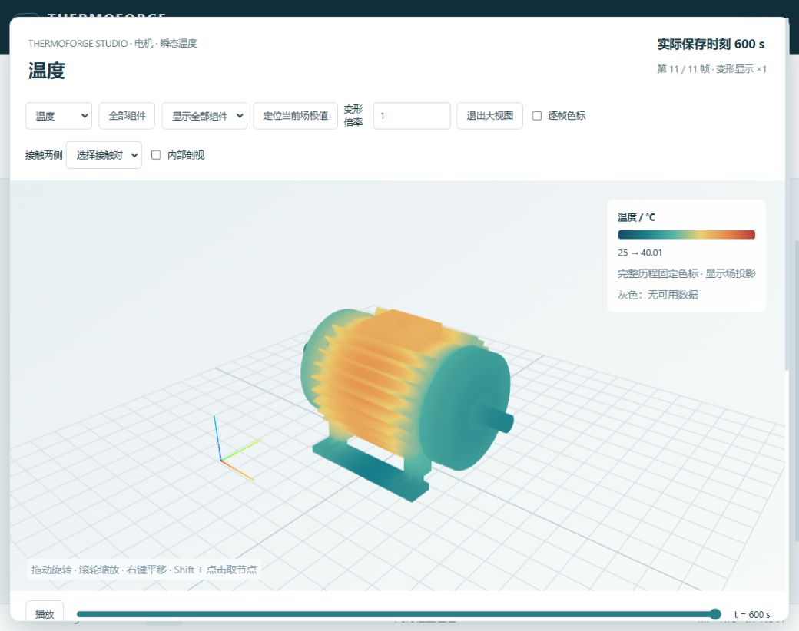
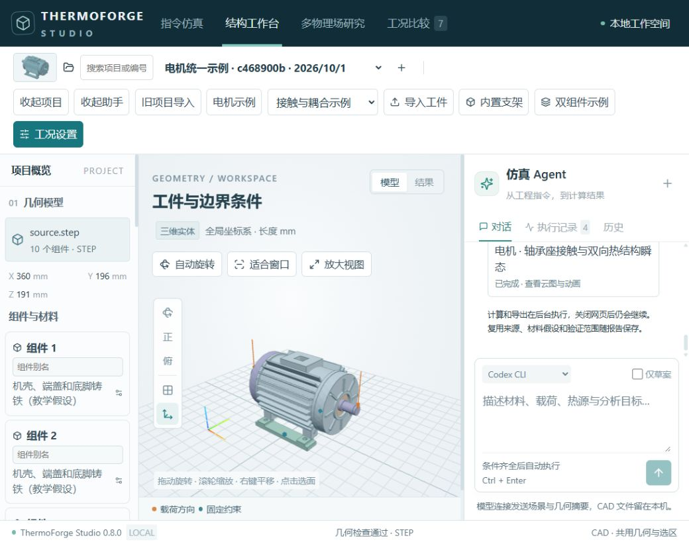
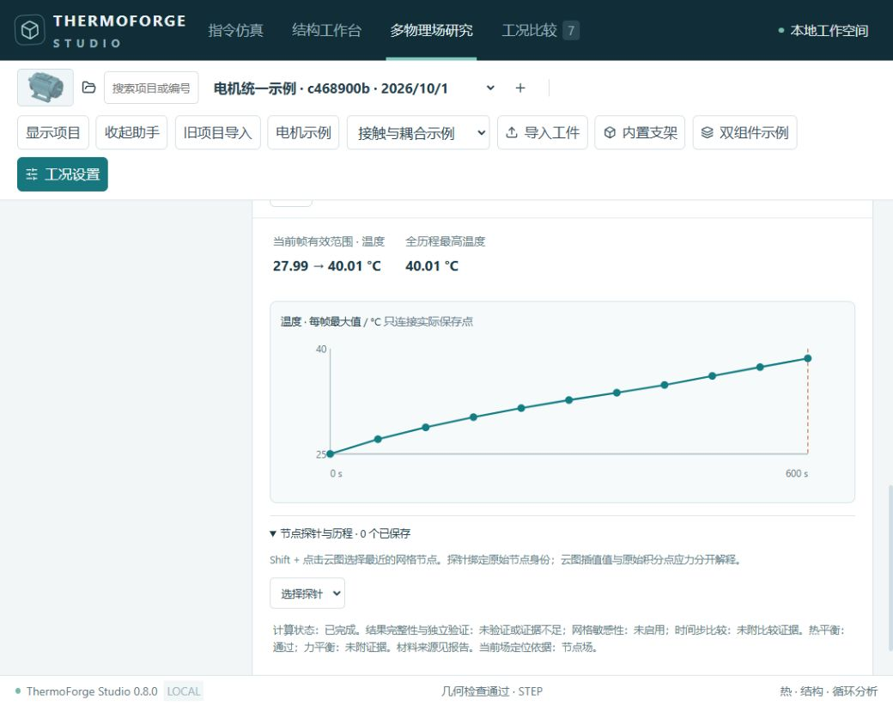

# ThermoForge Studio

**A local Windows workspace for thermal, structural, fatigue and contact-coupled analysis. Import CAD, describe a complete analysis in one prompt, inspect actual saved frames, and export videos and Chinese engineering reports.**

[完整中文文档](README.md) · [Screenshot gallery](docs/SCREENSHOTS.md) · [Releases](https://github.com/tianyuzong/ThermoForge-Studio/releases)



Version **0.8.0**, local address **http://127.0.0.1:8877**, default **six CPU threads and one heavy solver job**. This release was CPU-validated on **Windows x64 / Python 3.14**. The motor is a demonstration project, not a hard-coded workflow requirement.

## Contents

- [Install and run](#install-and-run)
- [Workflow](#workflow)
- [Complete prompt template](#complete-prompt-template)
- [Analysis methods and limits](#analysis-methods-and-limits)
- [Visualization and deliverables](#visualization-and-deliverables)
- [Reliability and evidence](#reliability-and-evidence)
- [Developer interfaces](#developer-interfaces)
- [Data and distribution](#data-and-distribution)

## Install and run

Download the source distribution and checksum from Releases, or clone this repository. Extract to a short path such as `C:\ThermoForgeStudio`. Without Windows long-path support, the full installation path should be shorter than 140 characters.

```powershell
git clone https://github.com/tianyuzong/ThermoForge-Studio.git
Set-Location ThermoForge-Studio
powershell -ExecutionPolicy Bypass -File .\Install.ps1
.\Start.bat
```

The installer creates a local virtual environment, installs CPU dependencies, downloads official CalculiX 2.23 with SHA-256 verification, and checks the video browser and encoder. Python 3.14 uses the checked-in lock file. Python 3.11+ is accepted by the installer, but other dependency combinations were not validated in this release.

Microsoft Edge is required by the default background video exporter. A prebuilt frontend is included; Node.js is needed only for frontend development. Initial installation needs internet access. This is a source-and-install-script distribution, not a self-contained executable or an offline installer.

```powershell
Invoke-RestMethod http://127.0.0.1:8877/api/v1/health
powershell -ExecutionPolicy Bypass -File .\Start.ps1 -Port 8878 -NoBrowser
.\Stop.bat
```

Closing the web page does not cancel background computation. Stopping the service does. Back up `data/` while the service is stopped before updating.

## Workflow

1. Select or create a project and import STEP. Check component count, dimensions and units.
2. Assign actual materials and save named face selections for supports, loads and thermal boundaries.
3. Use the main workspace's simulation assistant, or configure a study manually in the multiphysics section.
4. Review the parsed configuration and inherited parameters. Missing inputs are reported together instead of being invented.
5. The platform validates immutable case snapshots and runs the dependency queue. A general plan can contain 1–12 studies.
6. Inspect actual fields, time histories, component isolation, contact interfaces and probes.
7. Download PDFs, MP4s, CSV metrics, raw HDF5, snapshots and a ZIP with a hash manifest.



Natural-language planning uses an existing local Codex CLI or Responses API connection. Offline mode accepts exact saved-study commands or schema-compliant JSON; it does not parse arbitrary long natural language. The CAD file remains local, while the configured model connection receives project, geometry-summary, material and case context.

## Complete prompt template

Replace every bracketed field with information known for the current project. Remove analyses you do not need. Named selections and saved cases must exist.

```text
Analyze only the CAD model in the current project, using its existing components, material cards, named selections and connections. Do not import another demonstration. The model is used for [purpose]. Perform [static, steady thermal, transient thermal, high-cycle fatigue, thermo-mechanical coupling, cyclic contact/contact fatigue, as applicable]. Use [saved material cards, or per-component properties with sources]. Restrain [directions] on [actual named selection] and apply [total force/pressure/torque, direction and units] on [actual selection]. Apply [component power or surface heat flux], with [convection selection, coefficient, ambient temperature and emissivity if needed]. Initial temperature is [C], stress-free reference temperature [C], duration [s], step [s], saved-frame interval [s]. For fatigue use [load minimum/maximum or history], [target cycles] and [applicable calibrated S-N/Findley data]. For assembly contact use [explicit contact pairs, friction, motion, mechanical constraints, thermal links, closed-interface conductance and open-gap heat transfer]. Wear requires [hardness, wear coefficient and sources]; do not invent lifetime or wear when those inputs are absent. Give each study its own stated initial condition; continue from another result only when explicitly requested. When complete, validate and queue the analysis, inspect balance and available convergence evidence, display applicable stress, displacement, temperature, gradient, heat flux, damage, contact pressure and gap. Animate actual saved frames and export MP4, Chinese summary and per-study PDF, CSV, raw HDF5, immutable cases and a ZIP with hashes. Label static/steady rotation as non-transient presentation and cumulative fatigue as an assessment, not crack growth. Include assumptions, parameter sources, missing evidence and non-converged locations in the report. If essential information is missing or selections are ambiguous, list all missing inputs and retain this request for supplementation.
```

The Chinese UI contains a ready-to-fill template. See the [detailed prompt guide](docs/PROMPT_WORKFLOW.md). Use the draft-only checkbox to inspect a plan without solving.

## Analysis methods and limits

| Analysis | Implemented approach |
|---|---|
| Static | Small-displacement linear elasticity, quadratic tetrahedra, raw integration-point stress |
| Thermal | Steady/transient quadratic scalar discretization; heat sources, prescribed temperature/flux, convection, radiation, temperature curves and continuation |
| High-cycle fatigue | Signed equivalent stress, rainflow, Goodman and Miner; Findley critical planes for supported periodic multiaxial loading |
| Cyclic contact | CalculiX CPU surface-to-surface normal contact and optional Coulomb friction, quasi-static motion increments |
| Contact fatigue and wear | Rolling-contact-calibrated critical-plane relation, Archard wear from actual pressure and relative slip, blockwise surface updates |
| Thermo-mechanical | Partitioned thermal/structural iteration with pressure/gap-dependent interface feedback where configured |

Thermal and structural fields use matching quadratic mesh nodes. Display smoothing/projection is separate from raw stress assessment. Mechanical and thermal connections are configured independently; mechanical contact alone does not imply two-way heat-transfer feedback.

No low-cycle plasticity, crack propagation, arbitrary random non-proportional multiaxial fatigue, impact dynamics, lubrication-film solution or electromagnetic-loss solver is claimed. Missing fatigue calibration or failed elastic checks suppress unsupported lifetime predictions. Zero slip produces zero Archard wear, while fatigue may still accumulate.

Legacy thermal/static GPU paths remain available; the new contact and coupling paths are CPU-based. GPU was not revalidated during this optimization release.

## Visualization and deliverables

Default animations use actual saved times and a fixed history-wide color scale. Per-frame scaling is explicit. Static and steady results have no fabricated physical timeline. Legacy results lacking wear history display final wear only.

Component isolation, contact-pair views, field extrema and node probes support local inspection. Internal clipping clips surface geometry; it is not an interpolated interior volume section. Gray means unavailable data rather than zero. Deformation scaling changes the display only.



Reports have a table of contents and no appendices; methods, inputs and evidence are in the main text. The [42-page Chinese report](docs/media/motor-analysis-report.zh-CN.pdf) was generated by the platform from four real saved demonstration studies. It does not certify the physical motor or turn demonstration properties into measured materials.

Videos: [temperature](docs/media/thermo-temperature.mp4), [stress](docs/media/thermo-stress.mp4), [contact pressure](docs/media/contact-pressure.mp4), [gap](docs/media/contact-gap.mp4). Original MP4s are 1920×1080 at 24 fps. Extra encoded frames repeat saved states rather than inventing new solutions.

## Reliability and evidence

- Immutable case snapshots and persistent runs; closing a tab does not stop work.
- Project-scoped, versioned drafts and conflict detection.
- Unified preflight for UI, assistant and MCP, including component and selection validation.
- Initial thermal continuation validates source completeness, hashes and exact mesh identity.
- Reuse requires matching geometry, effective configuration, solver version and intact raw results.
- Cancellation affects only jobs owned by the current plan; completed reused history remains available.
- Interrupted tasks require explicit resume. Cancelled tasks do not restart automatically.
- Independent studies continue after another fails; dependent studies are blocked and partial delivery is labelled.
- Report/video-only re-export never starts a new solve and creates a separate delivery version.
- Verification evidence is bound to the actual result hash. Missing metrics or corrupt fields cannot be verified.

Recorded 0.8.0 tests: **232 passed / 18 skipped** in the unified/structural suite and **204 passed / 2 skipped** in the legacy thermal suite. These counts are historical release evidence, not a promise that every local model is validated. All large numerical benchmarks and GPU cases were not rerun. See [acceptance scope](docs/OPTIMIZATION_ACCEPTANCE_0_8.md).

## Developer interfaces

Open `http://127.0.0.1:8877/docs`. Schema endpoints are `/api/v1/studies/schema` and `/api/v1/analysis-plans/schema`.

```json
{
  "request_id": "unique-client-request-id",
  "provider": "cli",
  "prompt": "Complete analysis instruction",
  "execute": false,
  "force": false
}
```

POST to `/api/v1/projects/{project_id}/analysis-plans`. Query `/api/v1/analysis-plans/{id}`; supplement `needs_input` with `previous_plan_id`, or read `run_id` after submission. `execute:false` creates a draft only.

Use `/api/v1/analysis-runs/{id}` for status, `/cancel` and `/resume` for lifecycle. POST `/exports` with `{request_id,scope:"report"|"video"|"all"}` for independent re-export. Results expose a reusable topology endpoint and per-frame values. See [0.8 API notes](docs/OPTIMIZATION_0_8.md).

MCP setup: `Prepare-MCP.ps1`; generated connection lives in `.runtime/thermoforge-mcp.json`. The integration uses the same configuration validation and queue.

```powershell
.venv\Scripts\python.exe -m pytest tests -q
.venv\Scripts\python.exe -m pytest thermal_legacy\tests -q
powershell -ExecutionPolicy Bypass -File .\Install.ps1 -DevBuild
.venv\Scripts\python.exe scripts\build_manifest.py
.venv\Scripts\python.exe scripts\package_release.py
```

Frontend scripts include build, UI checks and study/run/prompt checks. Browser tests require their documented running service and existing result fixtures.

## Data and distribution

`data/`, `.runtime/`, `.venv/`, credentials and personal CAD imports are excluded from Git. The checked-in examples and media are selected demonstration assets. No automatic cleanup deletes historical results. `/api/v1/storage/inventory` is read-only.

The default service is local-only and is not an authenticated multi-user internet service. Do not expose it as a public SaaS by merely changing the bind address.

The source and frontend build are recorded by `BUILD-MANIFEST.json`; the release ZIP includes per-file hashes. The Windows installer downloads official solver binaries rather than redistributing them in this repository.

Upstream commits are preserved in [SOURCE_VERSIONS.json](SOURCE_VERSIONS.json). Third-party notices are in [THIRD_PARTY.md](THIRD_PARTY.md). This packaging task does not assign a new blanket license to all source code; there is no root project LICENSE. Review applicable source and dependency terms before redistribution.
