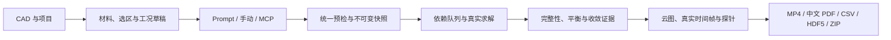

# ThermoForge Studio

**Windows 本地热、结构、疲劳与接触耦合仿真平台。导入 CAD，用一段完整指令组织分析，在同一个工作台查看真实计算帧、导出视频与中文报告。**

[安装启动](#install) · [完整 Prompt](#prompt) · [操作流程](#workflow) · [全部截图](docs/SCREENSHOTS.md) · [报告视频](#delivery) · [验证范围](#validation) · [English](README.en.md)

版本 **0.8.0** · 默认地址 **http://127.0.0.1:8877** · 默认 **CPU 六线程 / 一个重型作业** · 本轮验收 **Windows x64 / Python 3.14**


*真实工作台截图。电机是演示模型；600 s 温度云图来自已保存结果，采用全历程固定色标。平台主流程面向当前项目，不会因输入“全套分析”自动加载电机。*


*由平台 MP4 制成的缩小预览。播放速度经过压缩，物理时刻以画面标注为准；补帧只重复已有画面，不生成新的求解结果。[原始 1080p MP4](docs/media/thermo-temperature.mp4)。*

## 目录

1. [平台概览](#overview)
2. [能力与适用边界](#capabilities)
3. [安装、启动、停止和更新](#install)
4. [第一次使用：从 CAD 到交付](#workflow)
5. [一整段 Prompt：可复制模板](#prompt)
6. [离线模式与手动配置](#offline)
7. [材料、选区、单位与草稿](#configuration)
8. [各类分析的配置与结果含义](#analyses)
9. [动态可视化、局部视图与探针](#visualization)
10. [PDF、MP4、CSV、HDF5 和 ZIP](#delivery)
11. [队列、复用、取消和恢复](#lifecycle)
12. [示例、数值验证与证据范围](#validation)
13. [架构与目录布局](#architecture)
14. [HTTP API 与 MCP](#api)
15. [开发、测试与源码打包](#development)
16. [数据、备份、导入和本地访问](#data)
17. [常见问题与排障](#troubleshooting)
18. [来源、许可与文档索引](#references)

<a id="overview"></a>
## 1. 平台概览

ThermoForge Studio 整合 [Strength Studio](https://github.com/tianyuzong/strength-studio) 的 React / Three.js 工作台、FastAPI / SQLite 项目管理与结构分析，以及 [ThermoForge](https://github.com/tianyuzong/ThermoForge) 的热分析能力。固定来源提交见 [SOURCE_VERSIONS.json](SOURCE_VERSIONS.json)。

一个项目共享 CAD、组件、材料、命名选区与历史工况。界面、自然语言和 MCP 使用相同的配置与预检。自然语言只生成类型化计划，平台负责校验、排队、真实求解、结果读取与报告；语言模型不生成计算结果。

**主流程是通用的，电机、轴承和齿轮只是示例。** 一份计划可包含 1～12 个研究。只安排明确要求且条件完整的分析；缺少材料、选区、疲劳曲线或连接时集中列出，不猜面编号或材料参数。




*主界面保留项目、组件、模型和仿真助手。左右面板可收起，结果可放大。*

<a id="capabilities"></a>
## 2. 能力与适用边界

| 研究 | 方法与输出 | 必须给出的条件 |
|---|---|---|
| `static` 静力 | 线弹性小变形、二阶四面体；原始应力、位移、支反力 | 材料、载荷、支撑与组件连接 |
| `thermal_steady` 稳态热 | 二阶标量热离散；温度、梯度、热流 | 热源、导热系数、散热或温度边界 |
| `thermal_transient` 瞬态热 | 时间推进与实际保存帧；升温、热点、热流历程 | 密度、比热、初温、时长、步长与保存间隔 |
| `fatigue` 高周疲劳 | 雨流、Goodman、Miner；周期多轴 Findley；寿命状态、损伤与萌生危险位置 | 对应材料曲线、载荷历史与弹性适用性 |
| `contact_cycle` 周期接触 | CalculiX CPU 准静态面对面接触；压力、滑移、面积、间隙和应力历史 | 接触两侧、摩擦、运动与支撑 |
| `contact_fatigue` 接触疲劳 | 对应滚动接触条件标定的临界平面关系；Archard 磨损 | 专用疲劳标定、硬度、磨损系数与来源 |
| `thermo_mechanical` 热结构 | 热—结构分区迭代，压力/间隙反馈界面传热；装配应力和间隙变化 | 参考温度、机械及热连接、界面热导 |

新热结构计算使用匹配节点的二阶网格，不做最近邻温度映射；接触两侧保留独立自由度。疲劳读取原始积分点应力，平滑/投影云图只用于显示。

已有热和静力 GPU 路径保留；新增周期接触与耦合用 CPU。本轮优化验收没有重新验证 GPU。旧结构“工况设置”中关于 GPU 齿轮的说明仅属于原工作台，新 CPU 周期接触在“多物理场研究”中配置。

当前不包含低周塑性疲劳、裂纹扩展、任意非比例随机多轴疲劳、冲击动力学、润滑油膜或电磁损耗求解。“裂纹萌生危险位置”不等于裂纹形状或扩展轨迹。S-N 寿命是萌生还是失效，以输入曲线定义为准。

计算完成、力/热平衡通过、网格/步长验证通过、材料经过实测标定是不同结论，不能互相替代。

<a id="install"></a>
## 3. 安装、启动、停止和更新

### 3.1 环境要求

| 项目 | 要求与说明 |
|---|---|
| 系统 | 本轮安装验证为 Windows x64；不承诺当前脚本支持 Linux/macOS |
| Python | 推荐本轮验收的 64 位 Python 3.14；安装器接受 3.11+，其他依赖组合尚未验收 |
| 浏览器 | 现代浏览器访问工作台；后台 MP4 导出默认使用已安装的 Microsoft Edge |
| 网络 | 首次安装下载依赖和官方 CalculiX；长自然语言另依赖所选模型连接 |
| CPU/GPU | 默认 CPU 六线程、重型求解串行；新增功能无需 GPU |
| 内存与磁盘 | 取决于网格、物理步、接触迭代与重启动文件；按实际预检，不给虚构统一容量保证 |
| 路径 | 未启用长路径时完整安装路径应少于 140 字符，例如 `C:\ThermoForgeStudio` |
| Node.js | 普通安装使用随包前端构建；仅修改前端时需要开发环境 |

发布物是**源码和 Windows 安装脚本发行包**，不是单文件 EXE，也不是完全离线安装器。

### 3.2 使用 Release 安装

从 [Releases](https://github.com/tianyuzong/ThermoForge-Studio/releases) 下载 `ThermoForge-Studio-0.8.0-source.zip` 和同名 `.sha256.json`，解压后在 `ThermoForge-Studio` 目录打开 PowerShell：

```powershell
python --version
python -c "import sys; print('64-bit:', sys.maxsize > 2**32)"
powershell -ExecutionPolicy Bypass -File .\Install.ps1
.\Start.bat
```

安装器创建 `.venv`、安装 CPU 依赖、下载官方 CalculiX 2.23 并核对 SHA-256，再检查视频浏览器与编码器。Python 3.14 使用 [锁文件](requirements-windows-py314.lock)。

打开 **http://127.0.0.1:8877**。只读健康检查：

```powershell
Invoke-RestMethod http://127.0.0.1:8877/api/v1/health
```

### 3.3 从仓库安装

```powershell
git clone https://github.com/tianyuzong/ThermoForge-Studio.git
Set-Location ThermoForge-Studio
powershell -ExecutionPolicy Bypass -File .\Install.ps1
.\Start.bat
```

私有仓库需要已有 GitHub 访问权限。Git 不包含运行数据库、个人 CAD、虚拟环境、依赖缓存或 `ccx.exe`。大型历史诊断仅随 Release 分发，见 [仓库内容清单](docs/REPOSITORY-CONTENTS.json)；它不是运行所需输入。

### 3.4 启停与端口

```powershell
# 日常启动
.\Start.bat

# 另一个端口，不自动打开网页
powershell -ExecutionPolicy Bypass -File .\Start.ps1 -Port 8878 -NoBrowser

# 停止本目录管理的服务及计算子进程
.\Stop.bat
```

关闭网页不终止计算。`Stop.bat` 会停止服务。不同副本请使用不同端口；启动器发现同端口已有平台时会打开既有服务，不替换其数据目录。

### 3.5 更新与回退

1. 结束或取消活动任务，用 `Stop.bat` 停止本目录服务。
2. 备份完整 `data/` 和个人 `local-settings.json`，保留旧安装目录。
3. 将新版解压到新目录并安装，按需要复制停机后的完整 `data/`。
4. 启动后核对版本、项目和结果。不要手工合并两个 SQLite 数据目录。
5. 旧结果保留旧算法和证据范围；升级界面不代表重新通过数值验收。

<a id="workflow"></a>
## 4. 第一次使用：从 CAD 到交付

### 4.1 导入和识别模型

选择项目或“新建项目”，点击“导入工件”选择 STEP。导入后核对组件数量、单位与外形尺度。项目选择器显示实际 CAD 缩略图、短编号和更新时间，可按名称或编号搜索。

电机、内置支架、双组件、局部滚动体、热致闭合和标准齿轮可用于学习流程。选择示例会明确加载示例项目；普通 Prompt 不会隐式切换模型。

### 4.2 准备真实边界与材料

选中载荷、约束或热边界作用面，保存为“安装面”“输入端”“散热外壳”等命名选区。选区绑定几何版本与组件，不能跨 CAD 直接复用面编号。

逐组件指定材料，核对弹性、热学、疲劳或接触参数及来源。牌号名称不能代替状态、温度和适用条件。


*工况材料独立保存；之后修改项目材料不会改写历史快照。*


*载荷绑定真实组件和表面，区分总力、压力、方向与单位。图中的 1000 N 是电机演示条件。*

### 4.3 在主界面组织仿真

点击“指令仿真”或使用右侧“仿真 Agent”，选择连接，粘贴完整 Prompt。勾选“仅草案”可先检查；不勾选时完整条件通过预检后自动执行。

展开“查看已解析的工况”核对配置、继承来源与修改项。缺项时补充原指令；新目标用“新对话”。不要为了启动任务而填写未知参数。

### 4.4 读取结果并交付

右侧显示计划、计算、校核与导出进度；中央和左侧可切换研究。时间轴只用于真实瞬态/周期帧。完成后下载汇总/分项 PDF、MP4、CSV、HDF5 或 ZIP。关闭页面后重新进入项目可继续查看；过去的指令在“历史”中打开。

<a id="prompt"></a>
## 5. 一整段 Prompt：可复制模板

将 `【】` 替换成自己的已知条件，删除不需要的分析和参数。材料、组件、工况与选区名称必须真实存在。

```text
请针对当前项目中的 CAD 模型执行仿真，使用本项目已有的材料卡、组件、命名选区和连接配置，不导入其他示例。模型用途是【填写用途】，需要的分析为【静力、稳态热、瞬态热、高周疲劳、热结构耦合、周期接触及接触疲劳，按需保留】。材料使用【明确的已保存材料卡名称，或逐组件给出物性与来源】；在【真实命名选区】固定【X/Y/Z 方向】，在【真实命名选区】施加【方向、总力/压力/扭矩及单位】。热源设置为【组件总功率或表面热流】，散热设置为【选区、对流系数、环境温度，必要时发射率】，初始温度【℃】，无应力参考温度【℃】，瞬态时长【s】，时间步【s】，每【s】保存一帧。疲劳使用【载荷最小值、最大值及周期/时间历程】，目标【循环数】，采用【已保存的 S-N 或 Findley 数据及适用条件】。装配分析使用【明确的粘结或开闭接触对、摩擦、运动历史、机械约束、热连接、接触热导与间隙传热条件】；磨损使用【材料硬度、磨损系数及来源】，没有这些数据就不要推测寿命或磨损。各研究独立使用指定初始条件，只有我明确要求时才以前一研究结果续算。条件齐全后自动排队求解、检查结果，提供适用的应力、位移、温度、梯度、热流、疲劳危险位置、接触压力与间隙结果；用真实保存帧播放动态云图并导出 MP4、中文汇总与各工况 PDF、指标 CSV、原始 HDF5、工况快照及带哈希清单的 ZIP。静力与稳态标为非瞬态视角展示，累计寿命与损伤不画成裂纹生长。参数、来源、演示假设、未收敛项与未评估项写入报告。缺少关键条件或选区含义不明确时，一次列齐需要补充的内容，保留原指令供我补充。
```


### 5.1 已经保存好工况的写法

```text
只对当前项目执行分析。继承已保存的“静力基准”中的材料、支撑、连接与网格，将“端面力”改为沿 -Z 的 500 N；另建瞬态热工况，继承已保存的“升温工况”中的热源、散热与材料，初始温度设为 25 ℃，总时长 600 s、步长 10 s、保存间隔 30 s。两项独立执行，不加载其他示例，也不添加疲劳工况。条件完整后自动求解、生成真实温度帧动画和静力视角视频，导出中文报告、CSV、HDF5 与 ZIP；缺失条件一次列出，不擅自补参数。
```

示例中的两个工况和“端面力”必须存在。较早历史可明确写出研究 ID，或通过 API `base_case_ids` 指定，避免只凭同名工况猜来源。

### 5.2 需要收敛检查时追加

```text
为指定研究增加三档网格敏感性比较；对瞬态热结构增加时间步减半比较，最多减半六次。保留每次计算和失败诊断。求解完成、力/能量平衡、网格敏感性与步长验证分别报告，不提前宣称已验证。资源不足时停止并说明，不自动减载或粗化网格。
```

这会增加计算成本。对应字段为 `case.mesh.convergence=true`、瞬态研究的 `time_step_validation=true`。证据只覆盖实际比较过的工况、指标和原始结果哈希。

### 5.3 三种连接方式

| 方式 | 使用场景 | 连接条件 |
|---|---|---|
| Codex CLI | 长自然语言规划 | 本机已有 CLI 与登录配置 |
| Responses API | 长自然语言规划 | 本机已有 API 连接配置 |
| 本地规则（离线） | 精确研究 ID 指令或 schema JSON | 无需模型 API；不理解任意长自然语言 |

模型连接接收场景、几何摘要、材料与配置上下文；CAD 文件留在本机。上下文仍可能包含业务信息，应选择适合该项目的连接。不要把凭证写入 Prompt、报告或仓库。

<a id="offline"></a>
## 6. 离线模式与手动配置

离线求解不需要模型 API。选择“本地规则（离线）”，填写当前项目的实际研究 ID：

```text
运行已保存研究 研究编号一,研究编号二
```

也可按 `/api/v1/analysis-plans/schema` 提交 JSON。`case_json` 是 JSON 字符串；带 `base_case_id` 时递归覆盖对象，**数组整体替换**，未提及字段保留。

手动操作：“多物理场研究”→“配置研究”→分析类型→材料与网格→相应边界/载荷历史/接触→“校验并计算”。草稿按项目、几何和类型自动保存，不完整草稿可以保存，但不能进入求解。


复杂配置保留高级 JSON。表格显示单位可能不同于 schema 的 SI 单位，应按标签转换后填写。

<a id="configuration"></a>
## 7. 材料、选区、单位与草稿

### 7.1 单位

| 物理量 | 工况/API 基本单位 | 常见界面显示 |
|---|---|---|
| 长度、网格尺寸、间隙 | m | mm、μm；CAD 工作区 mm |
| 总力 / 力矩 | N / N·m | N / N·m |
| 应力、压力、模量、硬度 | Pa | MPa、GPa |
| 温度 / 时间 | °C / s | °C / s；温差可用 K |
| 密度 / 比热 | kg/m³ / J/(kg·K) | 同左 |
| 导热系数 | W/(m·K) | 同左 |
| 对流 / 界面面热导 | W/(m²·K) | 按字段标签 |
| 体热源 / 组件总功率 | W/m³ / W | 先选择正确热源类型 |
| 热膨胀系数 | 1/K | 可显示为 10⁻⁶/K |
| 疲劳循环 | 次数 | 不等同于物理时间 |

常数与曲线共用物理校验，每个曲线点都检查。负对流系数、发射率不在 0～1、低于绝对零度的温度和倒置温控上下限会在求解前被拒绝。

### 7.2 材料来源与适用性

填写参数来自用户输入、材料卡、模板、演示还是实测。S-N、Findley、滚动接触标定和磨损系数需要适用条件。缺少疲劳数据可以只完成应力分析，不能输出猜测寿命。

### 7.3 草稿与结果快照

当前草稿可编辑，求解快照不可变；修改草稿不改写历史。多窗口保存有版本冲突检查。组件别名便于阅读，底层编号保持稳定。

CAD、组件或选区变化后重新解析与预检。温度续算核对来源完整性、原始场哈希和相同网格/节点身份，并记录实际采用的来源及物理时刻。

<a id="analyses"></a>
## 8. 各类分析的配置与结果含义

### 8.1 静力

核对材料、约束方向、载荷面和组件连接。总力按选面分布，不能当作每节点力。独立组件计算和理想粘结传力不是同一个假设。结果包括位移、应力和支反力。

尖角、理想固定边或未收敛局部峰值需标识，不能直接用于“已验证寿命”。


*非瞬态视角展示。云图用投影应力着色，评估取原始积分点值。*

### 8.2 稳态和瞬态热

支持组件发热、体热源、热流、指定温度、对流、辐射、环境温度曲线、温控、相变和续算。稳态发热应有合理散热路径；瞬态需密度、比热、初温、时长、步长和保存间隔。

稳态末温不会自动作为瞬态初温。新装配使用独立界面传热模型；旧等效材料热阻留在兼容路径。


*稳态结果没有升温时间轴。稳态最高温度与 600 s 瞬态末温属于不同物理状态。*

### 8.3 高周疲劳

支持恒幅、分级载荷谱和 CSV 历程，载荷名称与倍率需对应。在线弹性成立时复用单位载荷应力场。比例载荷采用带符号等效应力、雨流、Goodman 和 Miner；周期多轴使用 Findley。

结果为目标循环损伤、寿命状态、危险组件/位置、临界平面和应力循环。曲线缺失、超弹性范围或周期条件不满足时保留原因，不填猜测寿命。累计寿命不播放成裂纹增长。


*这里低于给定演示疲劳极限，不预测有限寿命；不据此承诺实物无限寿命。*

### 8.4 接触疲劳和磨损

配置接触两侧、法向罚刚度、可选摩擦、转轴/路径/运动历史与机械支撑。每个准静态增量匹配接触面，保留材料点身份和随体应力历史。

滚动接触疲劳需要对应条件标定关系，不拿普通拉伸 S-N 宣称轴承寿命。Archard 磨损读取实际压力、相对滑移、硬度和系数；零滑移磨损为零，但疲劳仍可累积。循环块更新表面偏置后重新求解。

新版保存逐帧累计磨损；旧结果若只有最终磨损，就仅展示终值，不复制成伪时间历程。


*独立局部模型与专用演示材料；不能据此宣称整机轴承实物寿命。*

### 8.5 热结构耦合

初始温度决定瞬态起点，无应力参考温度决定热应变基准。机械连接和热连接单独配置。

有效双向反馈为 **温度 → 热膨胀/接触 → 压力/间隙 → 界面热导 → 温度**。只有机械接触、没有热反馈时按单向耦合说明。

默认阈值：温度变化 ≤0.01 K、位移相对变化 ≤10⁻⁴、界面热流相对变化 ≤10⁻³，最多 30 次松弛迭代。瞬态失败按策略减半步长、最多六次；仍失败则记录时刻和诊断。试算不重复累计已经提交的摩擦/磨损历史。


*仅有效映射区域显示相应场。灰色不是零；该粗步长演示的计算完成不表示所有网格/步长检查通过。*

<a id="visualization"></a>
## 9. 动态可视化、局部视图与探针

| 操作 | 读取方式与含义 |
|---|---|
| 场切换 | 按实际数据提供温度、应力、位移、压力、间隙、损伤和磨损 |
| 时间轴/播放 | 真实保存时刻，按实际时间比例播放；不生成中间求解帧 |
| 固定色标 | 默认全历程范围；逐帧范围需要主动勾选并提示 |
| 组件隔离 | 单独查看组件、内部零件或恢复全部 |
| 接触两侧 | 选择接触对，减少壳体遮挡 |
| 内部剖视 | 表面几何裁剪，不是插值求得的内部体截面场 |
| 极值定位 | 根据当前场保存数据定位危险位置 |
| 变形倍率 | 只改变显示，不改变求解；图和视频保留倍率标注 |
| 节点探针 | Shift + 点击选择最近网格节点，绑定原始节点身份 |
| 同步历程 | 连接实际保存点，区分当前值、全历程极值和累计量 |
| 工况比较 | 原静力与新研究统一列出；检查几何、单位、场和时刻可比性 |


固定拓扑只传一次，后续读取场值与位移；相邻帧缓存和过时请求取消减少重复读取。色标索引绑定结果哈希，文件变化后旧证据失效。

<a id="delivery"></a>
## 10. PDF、MP4、CSV、HDF5 和 ZIP

| 文件 | 内容 |
|---|---|
| 中文汇总 PDF | 目录、模型/组件、材料来源、边界、网格、指标、云图、历程、验证与局限 |
| 分项 PDF | 单研究配置、结果与检查 |
| MP4 | 1920×1080 / 24 fps，固定相机/色标，注明物理时间、单位和倍率 |
| CSV | 与原始数据、网页和报告核对的指标 |
| HDF5 | 版本化节点、体积分点、接触积分点及时间/循环数据 |
| JSON | 不可变工况、来源与假设 |
| ZIP | 全套可用产物与逐文件哈希清单 |

**报告包含目录，没有附录；条件、证据和限制写在正文。** 每张云图说明研究、变量、单位、时刻与投影口径。缺少数据时说明原因，不补造图表。单项异常可以生成部分报告，首页注明完成范围。

以下直接渲染自平台生成的 [42 页中文示例报告](docs/media/motor-analysis-report.zh-CN.pdf)，没有另编展示用报告：

| 首页与完成范围 | 目录 |
|---|---|
|  |  |

| 材料与来源 | 温度与热流 |
|---|---|
|  |  |

| 真实时间历程 | 接触与间隙 |
|---|---|
|  |  |

该报告包含 4 个研究，是通用计划的交付，并非固定六项模板。疲劳/局部轴承有各自示例报告。演示参数不能表述为电机实测材料或实物寿命验证。

视频：[耦合温度](docs/media/thermo-temperature.mp4) · [耦合应力](docs/media/thermo-stress.mp4) · [接触压力](docs/media/contact-pressure.mp4) · [间隙](docs/media/contact-gap.mp4)。GitHub 内嵌播放取决于页面支持，可下载后本地播放。

<a id="lifecycle"></a>
## 11. 队列、复用、取消和恢复

计划、研究、导出持久化保存。网页关闭不停止计算；队列显示阶段、最近进展、位置和资源，不编造剩余时间。

默认一个重型作业、CPU 六线程。预检考虑网格、物理步、迭代、减步与重启动文件；空间不足时明确停止，保留已提交阶段，不减载或自动粗化。


### 11.1 完全匹配复用

核对几何/选区、配置、网格、求解代码/后端版本、原始哈希和完整性后才复用。来源显示在页面与报告；改条件会失效。“强制重新求解”建立新记录，不覆盖历史。

### 11.2 取消与重启

- 只终止本计划拥有的新建活动作业和导出，不影响其他项目或复用历史。
- 子节点同步完成、取消、依赖阻断和可恢复状态。
- 服务重启将未完成任务标为中断，点击“继续未完成任务”显式恢复。
- 已取消任务不会自动重启。
- 独立工况继续执行；依赖失败结果的工况阻断。
- 收敛热物理步逐步落盘并带完整性标记，但检查点不保证任意位置均可安全续算。

### 11.3 仅重新导出

“仅报告”“仅视频”“全部导出”都使用既有原始场，不启动求解。交付按版本另存，历史不覆盖；可以独立取消、查看日志和重试。修复视频环境后不必重做耗时仿真。

<a id="validation"></a>
## 12. 示例、数值验证与证据范围

| 示例 | 内容 | 范围说明 |
|---|---|---|
| 十组件电机 | 静力、热、疲劳、轴承座耦合 | 演示参数；流程成功不是局部收敛证明 |
| 局部滚动体—滚道 | 接触周期、疲劳、滑移与磨损 | 独立参数化模型，不等同整机简化轴承环 |
| 热致间隙闭合双块体 | 开闭接触、热反馈、步长比较 | 通过细步长与失败粗步长分别保存 |
| 标准渐开线齿轮 | 单齿节运动、接触连续性与平衡 | 默认 18°；整周配置标为未验收 |
| Hertz 点/线接触 | 与解析压力和接触区比较 | 特定网格、罚刚度与误差阈值 |
| 支架、双组件 | 材料、载荷、约束、连接和比较 | 非电机的通用流程示例 |

输入与便携 STEP 在 [examples/](examples/)，方法见 [UNIFIED_METHODS](docs/UNIFIED_METHODS.md)。

### 12.1 本轮 0.8.0 已记录结果

| 检查 | 结果 | 限定范围 |
|---|---|---|
| 统一平台/结构测试 | 232 通过、18 跳过 | 测试隔离修复后的全量记录 |
| 旧热平台测试 | 204 通过、2 跳过 | 独立热回归 |
| 前端 | TypeScript 构建及相关浏览器检查通过 | 界面验证不等于数值验证 |
| 缓存色标 HTTP | 本机空闲 10 次，P95 约 0.034 s | 与数据和硬件有关，非统一性能保证 |
| 帧一致性 | 首/中/末温度和位移核对 HDF5 | 压力按显示投影规则解释 |
| 视频 | 7 个 1080p / 24 fps 完整解码通过 | 静态展示/瞬态含义分开 |
| 安装 | 新目录、新虚拟环境、Windows x64 / Python 3.14 CPU 通过 | 既有 Windows 主机，不是全新 OS 镜像 |

证据见 [0.8.0 验收记录](docs/OPTIMIZATION_ACCEPTANCE_0_8.md) 及 `validation/optimization-*.json/xml/log`。定向测试可能与全量重复，不能把数量简单累加。

没有重新运行全部大型数值基准和 GPU 验证。历史证据只对应其原条件，不因新界面显示而自动升级。

### 12.2 验证标签怎么读

| 状态 | 证明 | 不证明 |
|---|---|---|
| 计算完成 | 求解与写出结束 | 材料真实或局部网格已收敛 |
| 力/热平衡通过 | 指定口径平衡误差达标 | 接触峰值、局部寿命已收敛 |
| 网格敏感性通过 | 所比较指标与有效研究达标 | 所有奇异点均可用于寿命 |
| 时间步通过 | 对齐的物理时刻和指标达标 | 未比较载荷或运动范围 |
| 演示材料 | 软件示例参数 | 实测、认证或实物标定 |

文件损坏、缺比较指标、缺子计算或证据过期不能显示 `verified`。证据绑定实际结果哈希。

<a id="architecture"></a>
## 13. 架构与目录布局

```text
ThermoForge-Studio/
├─ Install.ps1 / Start.bat / Stop.bat  安装和日常启停
├─ frontend/src/                      React / TypeScript / Three.js
├─ frontend/dist/                     随包前端构建
├─ strength/                          原项目、几何、静力、SQLite 和服务
├─ forge/                             统一平台
│  ├─ schemas.py / preflight.py       工况模型与唯一预检
│  ├─ plans.py / runs.py              指令计划和持久化任务
│  ├─ thermal.py / coupling.py        热与热结构
│  ├─ fatigue.py / contact.py         疲劳与周期接触
│  ├─ integrity.py / result_index.py  完整性与结果索引
│  └─ reporting/                     共用图文报告生成器
├─ thermal_legacy/                    旧热兼容命名空间
├─ examples/                          STEP、工况、回归参考、示例报告
├─ tests/ / validation/               测试与已记录证据
├─ docs/                              文档、截图、媒体、历史说明
├─ scripts/                           运行、验证、构建和打包
├─ integrations/                      MCP 连接与插件文件
├─ vendor/                            第三方声明；安装后生成求解器
├─ SOURCE_VERSIONS.json                固定来源
├─ BUILD-MANIFEST.json                 源码、前端、环境哈希
├─ data/                              运行数据，不入 Git
├─ .runtime/                          日志、进程与缓存，不入 Git
└─ .venv/                             Python 环境，不入 Git
```

SQLite 保存业务记录，独立进程执行重型计算，HDF5 保存版本化原始场。热模块隔离命名空间，避免双方 `solver`、`geometry`、`schemas` 名称冲突。

<a id="api"></a>
## 14. HTTP API 与 MCP

服务启动后打开 **http://127.0.0.1:8877/docs** 查看当前 OpenAPI。下表相对 `/api/v1`：

| 方法与路径 | 用途 |
|---|---|
| `GET /health` | 健康与版本 |
| `GET /studies/schema` | AnalysisCase schema |
| `GET /analysis-plans/schema` | 计划 schema |
| `GET /projects/{id}/analysis-context` | 实际模型、材料与可继承工况 |
| `POST /projects/{id}/analysis-plans` | 指令或离线 JSON 计划 |
| `GET /analysis-plans/{id}` | 解析状态、缺项和 run_id |
| `POST /projects/{id}/studies/validate` | 统一预检 |
| `GET/POST /projects/{id}/studies` | 项目分页历史/单研究提交 |
| `GET/PUT /projects/{id}/analysis-draft` | 带版本检查的草稿 |
| `GET /projects/{id}/analysis-comparison` | 可比性与指标 |
| `GET /analysis-runs/{id}` | 批次及子阶段 |
| `POST /analysis-runs/{id}/cancel` | 取消所属活动任务 |
| `POST /analysis-runs/{id}/resume` | 显式继续 |
| `POST /analysis-runs/{id}/exports` | 仅重新导出 |
| `GET /studies/{id}/result-index` | 范围、时刻和极值索引 |
| `GET /studies/{id}/topology` | 固定网格读取一次 |
| `GET /studies/{id}/frames/{i}/values` | 按需场值 |
| `GET/POST /studies/{id}/probes` | 节点探针 |
| `GET /execution/queue` | 阶段、排队与资源 |
| `GET /storage/inventory` | 文件分类和占用，只读 |

### 14.1 指令 API 示例

替换项目 ID 与指令。这里 `execute=false` 只生成草案；需要自动执行时设为 `true`。

```powershell
$base = 'http://127.0.0.1:8877/api/v1'
$projectId = '实际项目编号'
$payload = @{
    request_id = [guid]::NewGuid().ToString('N')
    prompt = '替换为完整仿真指令'
    provider = 'cli'
    execute = $false
    force = $false
} | ConvertTo-Json -Depth 20
Invoke-RestMethod "$base/projects/$projectId/analysis-plans" `
    -Method Post -ContentType 'application/json; charset=utf-8' `
    -Body ([Text.Encoding]::UTF8.GetBytes($payload))
```

查询返回的计划 ID。`needs_input` 时读取 `questions`，下次请求带 `previous_plan_id` 补充；`submitted` 时读取 `run_id` 并查询运行。客户端断开不取消后台任务。

### 14.2 独立导出

向 `POST /analysis-runs/{run_id}/exports` 发送：

```json
{"request_id":"客户端生成的唯一编号","scope":"report"}
```

`scope` 是 `report`、`video` 或 `all`。同一请求编号幂等；新导出按版本保存，旧产物不覆盖。

### 14.3 MCP

执行 `Prepare-MCP.ps1`，使用生成的 `.runtime/thermoforge-mcp.json` 或 [集成目录](integrations/thermoforge-studio/)。准备连接不修改旧插件安装。

工具包括 `studio_analysis_context`、`studio_submit_analysis_plan`、`studio_analysis_plan`、`studio_analysis_run`、`studio_cancel_analysis_plan`。当前模型直接组织配置并提交同一预检/队列，无需再嵌套规划模型。详见 [插件文档](docs/CODEX_PLUGIN.md)。

<a id="development"></a>
## 15. 开发、测试与源码打包

### 15.1 前端

```powershell
powershell -ExecutionPolicy Bypass -File .\Install.ps1 -DevBuild
```

或使用已配置 Node/npm：

```powershell
Set-Location frontend
npm ci
npm run dev
npm run build
```

开发代理连接后端 8877。生产工作台读取 `frontend/dist`，改 `src` 后需重建。

### 15.2 Python 和浏览器回归

```powershell
.venv\Scripts\python.exe -m pytest tests -q
.venv\Scripts\python.exe -m pytest thermal_legacy\tests -q
```

在 `frontend` 中执行：

```powershell
npm test
npm run test:studies
npm run test:runs
npm run test:prompts
```

浏览器脚本需要运行服务；部分还需要已有示例结果。使用 `STRENGTH_URL`、`STUDIO_PROJECT`、`STUDIO_RUN` 指定验收实例，先阅读脚本前置条件。不要把缺历史数据误判为算法错误。

### 15.3 数值与示例脚本

```powershell
.venv\Scripts\python.exe scripts\Run-Example.py thermal-gap
.venv\Scripts\python.exe scripts\Run-Study.py examples\motor-unified\thermo-contact.json --project 实际项目ID
.venv\Scripts\python.exe scripts\Validate-Motor.py --existing-study 实际研究ID
.venv\Scripts\python.exe scripts\Validate-OneClick.py 实际批次ID --wait
```

`Run-Example`/`Run-Study` 会计算；`Validate-Motor` 不带 `--existing-study` 会创建新回归。Hertz 开发脚本直接启动 CPU 求解器，需在工作台无重型任务时运行。具体局部网格、罚刚度和阈值见方法文档与脚本。

### 15.4 构建清单与压缩包

```powershell
.venv\Scripts\python.exe scripts\build_manifest.py
.venv\Scripts\python.exe scripts\build_manifest.py --verify
.venv\Scripts\python.exe scripts\package_release.py --output ..\ThermoForge-Studio-0.8.0-source.zip
```

清单绑定源码、前端构建、关键依赖、Python、平台与 CalculiX 哈希。打包器拒绝不一致版本。ZIP 内 `RELEASE-MANIFEST.json` 核对逐文件 SHA-256，旁边 `.sha256.json` 核对整个压缩包。

源码包排除个人设置、数据库、凭证、虚拟环境、缓存和第三方可执行库。`examples/` 与文档媒体是明确选取的演示资料。

<a id="data"></a>
## 16. 数据、备份、导入和本地访问

### 16.1 保留与备份

`data/` 包含 SQLite、模型、网格、原始场、快照、研究和导出。停机后整体备份它，并保留个人配置；不要在活动计算过程中只复制部分数据库文件。

设置参考 [local-settings.example.json](local-settings.example.json)，真实 `local-settings.json` 不入 Git。`.runtime/server.log`、`.runtime/server-error.log` 是服务诊断入口。

历史接触/耦合求解可能有大量中间文件；测试主机旧研究曾约 237 GiB，**不是新安装包大小或最低要求**。`/storage/inventory` 按原件证据、恢复必需、可再生成产物、待审阅诊断分类。当前不自动删除历史，不能仅凭扩展名删除仍用于恢复的文件。

### 16.2 旧数据导入

“旧项目导入”先复制到暂存区，核对来源及副本哈希再发布；失败保留诊断，原目录不改。旧热通过 `/legacy/thermal` 兼容读取，保留旧精度/算法/验证范围。


### 16.3 访问与凭证

默认只监听 `127.0.0.1`，检查本地 Host/Origin；不是带账户权限管理的公网多用户服务。不要直接改公网监听后当成 SaaS。

仓库不包含 GitHub token、API key、CLI 登录信息或用户运行数据库。发布前检查文件清单、凭证模式和大文件；这些检查不代替使用者对自己新增内容的审阅。

<a id="troubleshooting"></a>
## 17. 常见问题与排障

| 现象 | 检查与处理 |
|---|---|
| 找不到 Python / 指向商店 | 检查 `python --version` 和 64 位，配置受支持 Python 后重新安装 |
| 路径过长 | 解压到短路径，无需为本平台修改注册表 |
| CalculiX 哈希失败 | 检查下载和网络，重新获取官方固定版本；不要绕过校验 |
| Edge/视频环境缺失 | 修复已安装浏览器，重试安装检查与“仅视频” |
| 8877 被占用 | 查询健康接口确认服务，或另用 8878 |
| 页面还是旧版 | 核对服务目录、底部版本和前端 dist，启动正确副本 |
| 离线长 Prompt 无法识别 | 选择 CLI/API，或离线精确 ID/结构化 JSON |
| 解析不断要求补充 | 核对真实材料、选区、连接与疲劳曲线，不借用其他模型面号 |
| 有机械接触却写单向 | 检查是否真的启用压力/间隙热反馈，不能只改标签 |
| 温度续算被拒绝 | 检查来源完整性、原始哈希与相同节点/网格身份 |
| 云图灰色 | 查看是否有有效场/接触映射；灰色不等于零 |
| 寿命未输出 | 读取材料、弹性、周期闭合等诊断，缺条件可仅做应力 |
| 完全张开没有压力图 | 合法无接触可只给说明，需区分无接触与无有效映射 |
| 一直排队 | 看 `/execution/queue` 和当前重型作业，不重复提交 |
| 重启后未继续 | 中断任务需显式恢复，取消的任务不会自动运行 |
| 已求解但导出失败 | 查看独立导出日志与磁盘；修复后仅重导出 |
| 验证标记失效 | 原始哈希或证据发生变化，不能强行复用旧证据 |
| ZIP 很大 | 结果包包含 HDF5 和多个工况；可分别下载，勿与源码包混淆 |

反馈时提供版本、短编号、复现步骤和脱敏诊断/配置，不上传凭证和无关私有 CAD。

<a id="references"></a>
## 18. 来源、许可与文档索引

来源见 [SOURCE_VERSIONS.json](SOURCE_VERSIONS.json)，第三方下载、哈希与许可见 [THIRD_PARTY.md](THIRD_PARTY.md)、[前端声明](frontend/THIRD_PARTY_LICENSES.txt)。

本次封装没有擅自新增统一许可证或重新授权。仓库尚未设置统一根 LICENSE；使用和再分发时需核对各来源与第三方条款。CalculiX 从官方固定地址安装，源码 ZIP 不含其可执行文件或 NVIDIA 库。

| 文档 | 内容 |
|---|---|
| [截图总览](docs/SCREENSHOTS.md) | 实际界面、结果帧和 PDF 页，逐图来源 |
| [Prompt 工作流](docs/PROMPT_WORKFLOW.md) | 指令、补充条件、上下文与离线模式 |
| [0.8.0 使用与接口](docs/OPTIMIZATION_0_8.md) | 草稿、完整性、传输、导出与存储 |
| [0.8.0 验收记录](docs/OPTIMIZATION_ACCEPTANCE_0_8.md) | 测试、性能和实际范围 |
| [统一方法](docs/UNIFIED_METHODS.md) | 热、疲劳、接触、耦合与边界 |
| [通用流程验收](PROMPT_VALIDATION.md) | 指令/计划证据 |
| [旧电机套件验收](ONE_CLICK_VALIDATION.md) | 历史固定模板范围 |
| [原始验收汇总](VALIDATION.md) | 初期统一平台和数值题 |
| [MCP/插件](docs/CODEX_PLUGIN.md) | 工具集成 |
| [本次发布说明](docs/RELEASE_0_8.md) | 封装、截图和分发范围 |

`docs/` 保留上游历史说明，其旧端口、截图和验收结论仅对应原版本。当前操作以本 README、0.8.0 文档与运行 schema 为准。
