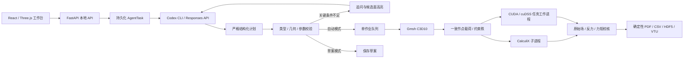

# 架构与接口

## 执行链路



`agent.py` 负责结构化规划；`service.py` 执行类型化宿主动作和状态机；`geometry.py`、`fem.py`、`solver.py` 构成计算引擎。CLI/API 输出为 `AgentDecision`，不提供任意工具名、代码或命令执行入口。格式问题最多两轮修正。编排器通过固定工具函数生成事件，并将几何与结果观察纳入后续上下文。

当前采用单次结构化任务计划加宿主自动流水线，而非让模型逐条决定网格/求解命令。已提交工况不依赖语言模型保持在线，求解、校核及报告由宿主完成。数值问题不会交给语言模型修改物理条件后偷偷重算。

## 持久化与版本

SQLite WAL 的 `entities` 存储 Project / Model / AgentTask / Job JSON 文档；Conversation 保存在任务中，SimulationPlan 保存为版本化 `cases`，ToolExecution 保存在 `events`。`requests(scope,token)` 为唯一幂等键。完整类型定义在 `schemas.py`，`LoadCase` 是手动表单和 Agent 共用的数据契约。

任务创建时绑定模型、材料、起始工况、会话、参考结果和计算后端。实际工况把命名选区解析为具体面 ID。每个计算目录保存独立 `config.json`，载荷修改生成新目录，不覆盖历史结果。提交后读取 CAD 时再次验证 SHA-256。

同一进程通过互斥锁与唯一请求表防止并发重放；队列使用一个 Semaphore。生产启动单个 Uvicorn worker，不支持把本版本作为多进程分布式调度器运行。幂等请求跨服务重启保留，原未完成任务标记为 interrupted，需要明确重新提交新任务才计算。

取消标记在计划返回、创建作业、等待槽位、启动子进程和轮询时检查，Windows 通过进程树终止 worker 及 CalculiX。页面关闭不影响服务。`Stop.ps1` 只停止与记录的 PID、Python 路径和模块名匹配的本服务。

## 主要接口

运行后完整 OpenAPI 为 <http://127.0.0.1:8876/docs>。

| 方法 | 路径 | 用途 |
|---|---|---|
| GET | `/api/v1/health` | 服务、CLI、求解器、GPU 检测和后端状态 |
| GET / POST | `/api/v1/projects` | 项目列表 / 创建 |
| GET / PATCH | `/api/v1/projects/{id}` | 项目、材料卡、后端配置 |
| POST | `/api/v1/projects/{id}/models` | multipart 导入 STEP/STL；units / body_tag |
| POST | `/api/v1/projects/{id}/demo` | 建立带圆角和孔的支架；另有 bar / beam 验证模型 |
| GET | `/api/v1/models/{id}` | 面、面积、法向、质心、包围盒、孔壁与命名选区 |
| GET | `/api/v1/models/{id}/display` | 三维外表面 |
| POST | `/api/v1/models/{id}/selections` | 保存明确面编号的命名选区 |
| POST | `/api/v1/projects/{id}/validate` | 参数与选区预检 |
| POST | `/api/v1/projects/{id}/jobs` | 手动工况进入同一自动流水线 |
| POST | `/api/v1/agent/tasks` | 自然语言任务，默认 auto |
| POST | `/api/v1/agent/tasks/{id}/messages` | 补充、草案启动、连续修改 |
| GET | `/api/v1/agent/tasks/{id}` | 计划、状态、问题、工况、事件、结果 |
| GET | `/api/v1/agent/tasks/{id}/events` | SSE；支持 Last-Event-ID |
| POST | `/api/v1/agent/tasks/{id}/cancel` | 取消及终止关联计算 |
| GET | `/api/v1/jobs/{id}` | 数值摘要、校核与不可变工况 |
| GET | `/api/v1/jobs/{id}/display` | 表面显示场 |
| GET | `/api/v1/jobs/{id}/slice` | 体单元切片 |
| GET | `/api/v1/jobs/{id}/files/{name}` | 白名单结果、报告、日志和项目归档 |

创建任务示例：

```json
{
  "project_id": "实际项目 ID",
  "prompt": "安装孔固定，顶面向下 1000 N，使用已保存材料并生成报告",
  "provider": "cli",
  "execution_mode": "auto",
  "request_id": "客户端生成且重试时保持不变的唯一值"
}
```

状态：`parsing`、`needs_input`、`validating`、`queued`、`meshing`、`solving`、`verifying`、`reporting`、`completed`、`partial`、`failed`、`cancelled`，以及 `draft`、`interrupted`。

## 有限元实现细节

Gmsh 二次四面体节点顺序的最后两条边与 CalculiX 不同，导出时交换相应中间节点。曲面三角形六节点，使用面积数值积分，将总力/压力映射成一致节点载荷；重力使用体积分。力和关于共同原点的力矩都与积分目标核对。网格非正 Jacobian、非连通组件、冲突边界和残余刚体自由度均拒绝求解。

CalculiX 输入数值采用长度小于 20 字符的科学记数法，避免程序截断指数。读取 DAT 中原始四积分点应力/应变，保留 `xx,yy,zz,xy,xz,yz` 顺序。结果显示场使用积分点外推和体积权重节点平均；不会覆盖原始数据。

三维剖切对每个 C3D10 采用八个线性子四面体，仅作为显示近似。峰值定位和强度评估仍使用原始积分点；不得把剖切插值值视为新的积分点解。

网格缓存按 CAD 哈希、网格配置、局部面集、加密倍率、Gmsh 版本和实现版本生成键，并校验文件哈希。目标大小相同的不同载荷复用同网格。网格失败只重新尝试一次质量优化；不改变 CAD 或目标尺寸。

## 本地运行边界

绑定 `127.0.0.1`，拒绝不匹配的 Host 与跨来源写操作。单用户本机应用，无公网认证/多租户设计。导入文件限制 100 MiB；只接受 STEP/STP/STL。结果文件通过白名单下载，Agent 不接触文件路径执行权。

当前限制：没有几何修复器、CAD 参数化编辑器或 ZIP 项目恢复界面；没有独立于工况求解的体网格预览任务。上述范围不影响从完整工况到真实结果和归档的自动闭环。

## 0.2 GPU 后端

新增 cudss_cuda，使用原生 CUDA/NVRTC 内存与内核适配器和 cuDSS 0.8。AgentDecision、TaskRequest、ProjectPatch 支持 compute_backend；明确自然语言设备指令优先，其次任务 API 指定、Agent 决策、项目默认。连续修改继承原任务后端，历史快照不迁移。

CPU 保留逐工况进程；GPU 使用任务专属 gpu-session 子进程和同一个全局求解槽位。宿主通过固定 stdin 协议提交本地作业目录，Agent 无命令/路径权限；工作进程检查作业父目录。分解仅在该任务进程内复用，任务结束释放。

POST /api/v1/execution/gpu-diagnostic 刷新分阶段诊断；GET /api/v1/health.execution 返回缓存诊断。任务 summary.execution 包含实际后端、GPU、精度、库和核哈希、阶段耗时、内存估计、分解复用和独立残差。
